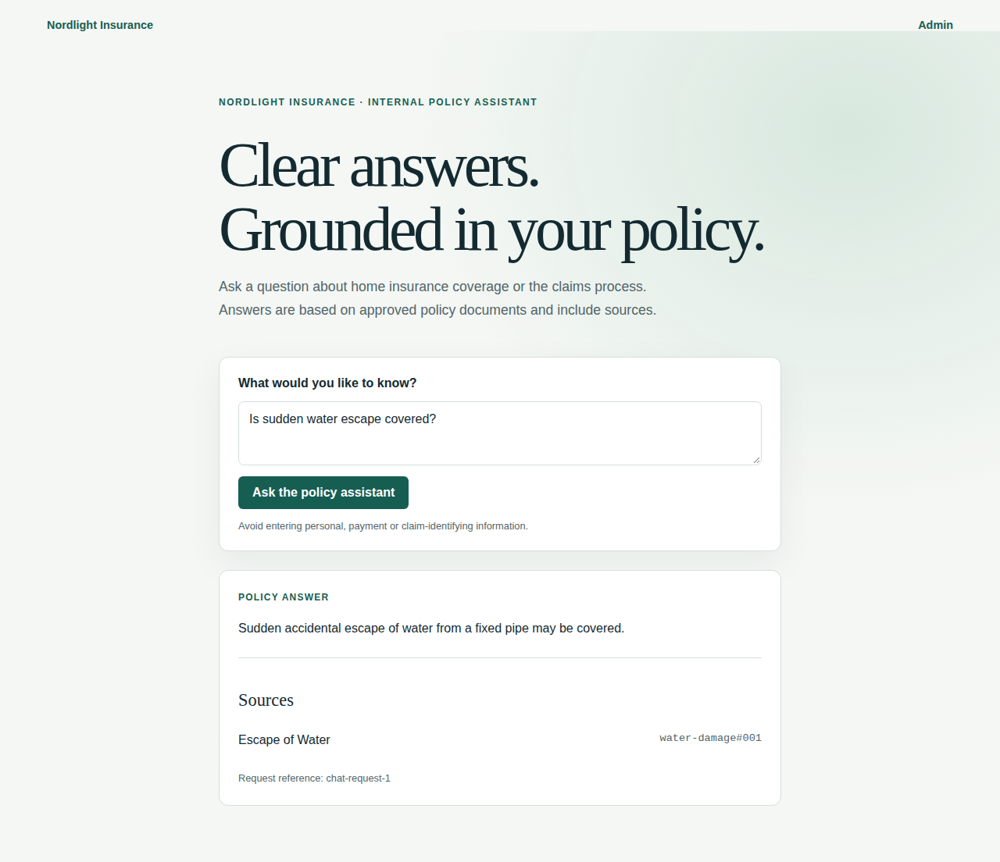
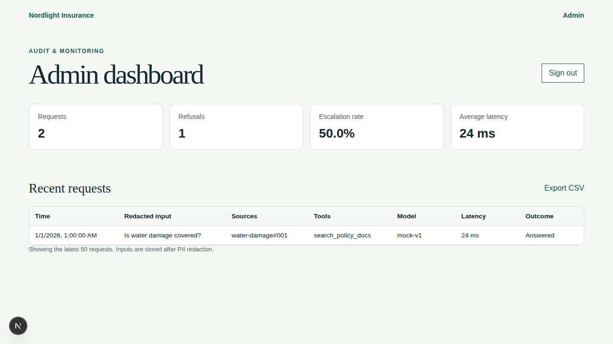
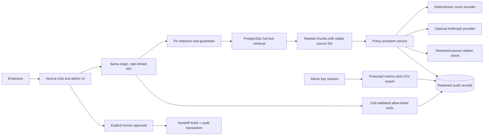

# Policy Assistant

A governed AI assistant for fictional Nordlight Insurance employees to ask questions about synthetic home-insurance terms and claims. It answers from approved Markdown summaries, validates source citations, redacts common PII, and offers a human-review handoff when evidence is insufficient.

> Portfolio prototype only. It does not make claim decisions and must not be used with real customer or insurer data.

## Screenshots

The screenshots show the mock-provider prototype with synthetic questions and audit rows.





## Quick start

Requirements: Docker Compose and ports `3000` and `5432` available. If host port `5432` is already in use, set `POSTGRES_PORT=5433` in `.env`; the app container continues to connect to PostgreSQL over Compose's private network.

```bash
docker compose up --build
```

Compose starts PostgreSQL, seeds the synthetic policy documents, then starts Next.js. Open [http://localhost:3000](http://localhost:3000). The mock provider is the default and requires no API key.

To enable the admin view, copy `.env.example` to `.env`, replace `ADMIN_API_KEY` and `RATE_LIMIT_HASH_SECRET` with long random values, then start Compose. Never commit `.env`.

## Using Claude

Claude API access is optional and billed separately from a Claude Max subscription. Set these values in `.env` and restart the app:

```dotenv
LLM_PROVIDER=anthropic
ANTHROPIC_API_KEY=your-own-api-key
ANTHROPIC_MODEL=claude-haiku-4-5-20251001
```

The provider API key is only read by the server. Automated tests and CI force the deterministic `mock` provider and do not need credentials.

## Architecture



### Knowledge base

`knowledge-base/` contains nine fictional policy summaries. At startup, the Compose `seed` service chunks and upserts them into PostgreSQL with stable IDs such as `water-damage#001`. Search uses PostgreSQL English full-text ranking; it is lexical, not semantic/vector search. Policy schedules, endorsements and claim records are not available to the assistant.

## Tests and evaluation

For local tests, keep the Compose PostgreSQL service running. If you changed `POSTGRES_PORT` and run tests or evaluation from your host, update the port in `DATABASE_URL` in `.env` to match (for example, use `localhost:5433`). Install the Playwright browser once:

```bash
npx playwright install chromium
npm test
npm run eval
```

`npm test` runs Vitest unit tests and Playwright API/browser tests. The API and evaluation tests use the seeded PostgreSQL data. If you do not already have `.env`, copy `.env.example` to `.env` first; the evaluation runner loads its Compose-mapped database URL automatically. `npm run eval` writes JSON and Markdown reports under `eval/reports/` and fails below defined correctness, citation, refusal, injection-resistance and PII-leakage thresholds or after a material regression from the accepted baseline.

The committed `eval/baseline.json` is intentionally uninitialized until a successful database-backed report has been reviewed. After review, copy the accepted metric scores into it; subsequent local runs compare against the previous report and CI compares against the committed accepted baseline.

Useful checks:

```bash
npm run test:unit
npm run test:api
npm run test:e2e
npm run lint
npm run type-check
npm run build
```

GitHub Actions runs lint, type-check, build, unit/API/E2E tests, and the mock-provider evaluation gate against PostgreSQL. Playwright and evaluation artifacts are uploaded by CI.

## API overview

| Method | Endpoint | Purpose |
|---|---|---|
| `POST` | `/api/chat` | Redacted, cited policy answer or refusal |
| `POST` | `/api/tools/estimate-claim-payout` | Deterministic illustrative payout calculation |
| `POST` | `/api/handoffs` | Create a ticket after explicit UI approval |
| `POST` / `DELETE` | `/api/admin/session` | Admin-key login and logout |
| `GET` | `/api/admin/data` | Protected metrics and recent audit entries |
| `GET` | `/api/admin/export` | Protected, formula-safe CSV export |

An importable Postman collection is available at [`postman/Policy-Assistant.postman_collection.json`](./postman/Policy-Assistant.postman_collection.json).

## Security, governance, and design

- [Security model and OWASP mappings](./docs/SECURITY.md)
- [Data handling and oversight](./docs/GOVERNANCE.md)
- [Architecture decisions](./docs/DECISIONS.md)
- `INTERVIEW_NOTES.md` is deliberately ignored by Git; it is a local plain-language guide to the design and demo.

## Limitations and next steps

- The documents are short synthetic summaries, not full contract wording; a citation does not establish coverage.
- Lexical retrieval can miss paraphrases. Low/absent evidence results in escalation rather than a coverage guess.
- PII detection is pattern-based and incomplete. Never enter real personal, payment, medical, or claim-identifying information.
- Chat has no employee identity/SSO. Same-origin checks and rate limits are not authentication.
- The demo uses a shared admin key and has no automated audit retention/deletion. Production needs SSO, roles, approved retention, authenticated approvals, monitoring, TLS, and proxy configuration.
- The evaluation set is a regression check, not proof of production accuracy.

Next steps for a production design would include reviewed/versioned policy data, authenticated employees, identity-bound approvals, retention and deletion workflows, semantic retrieval evaluation, stronger privacy detection, and independent security review.

## How this was built

This project was built with an AI coding agent under the author's direction and review. The author is responsible for reviewing the implementation and understanding its major design decisions and limitations before presenting it.
