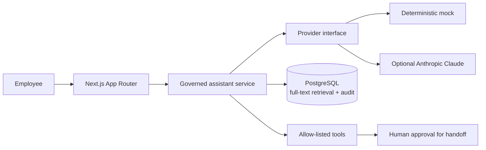

# Policy Assistant

A governed AI assistant for fictional Nordlight Insurance employees to ask questions about synthetic home-insurance terms and claims.

> This project is under active development. The chat interface is a scaffold; responses and policy content are not yet implemented.

## Quick start

Requirements: Docker Compose.

```bash
docker compose up --build
```

Open [http://localhost:3000](http://localhost:3000). The initial scaffold does not require an API key. For local development, copy `.env.example` to `.env` and run `npm install && npm run dev`.

## Architecture



## Development

```bash
npm test
npm run lint
npm run type-check
npm run build
```

## Planned

- Synthetic policy knowledge base with cited retrieval.
- PII redaction, validated tools, handoff approval, and auditable requests.
- Admin monitoring, evaluation suite, security/API/E2E tests, and CI.

## How this was built

This portfolio project was built with an AI coding agent under the author's direction and review. The author is responsible for reviewing the implementation and understanding its design and limitations before presenting it.
